# Менеджер задач

Консольное приложение на Python для управления списком задач: добавление,
просмотр, поиск по ID, изменение статуса, удаление, статистика и сохранение
данных в JSON.

**Дисциплина:** «Введение в программирование Python»
**Группа:** 9/4-РПО-23/1
**Автор:** Бацаценко Алеся Андреевна
**Учебный год:** 2025/2026

---

## 1. Возможности

- Меню из 7 пунктов, которое показывается после каждой команды.
- У каждой задачи есть уникальный числовой ID, название, приоритет
  (1 — низкий, 2 — средний, 3 — высокий) и статус («в работе» / «выполнено»).
- Новая задача автоматически получает статус «в работе».
- ID назначается автоматически: берётся наименьший свободный положительный
  номер. Если задачи 1 и 2 удалены, новая задача снова получит ID 1.
- Статус переключается в обе стороны: «в работе» → «выполнено» и обратно.
- Перед удалением программа запрашивает подтверждение.
- Данные сохраняются в `tasks.json` при выборе пункта «0» и загружаются
  при следующем запуске.
- Любой неверный ввод обрабатывается сообщением об ошибке, программа
  продолжает работу.

---

## 2. Структура проекта

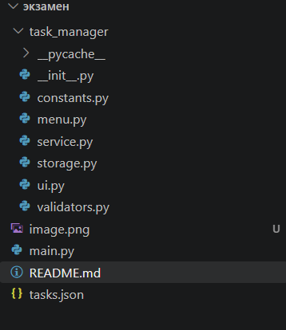

Логика разделена по слоям: `menu.py` отвечает только за интерфейс и вызовы,
`service.py` — за работу со списком задач, `storage.py` — за файл,
`validators.py` — за проверку ввода. Вся программа не находится в одном
большом цикле: каждый пункт меню реализован отдельной функцией.

---

## 3. Запуск

Требуется Python 3.9 или новее. Сторонние библиотеки не нужны.

```bash
cd экзамен
python main.py
```

На Windows, если команда `python` не найдена, используйте `py main.py`.
Файл `tasks.json` создаётся автоматически в папке проекта при первом
сохранении.

Если файла `tasks.json` нет, программа начинает с пустого списка. Если файл
повреждён или содержит некорректные записи, выводится предупреждение, а
программа продолжает работу с пустым списком (или с корректными записями).

---

## 4. Формат tasks.json

```json
[
  {
    "id": 1,
    "title": "Подготовить отчёт по практике",
    "priority": 3,
    "status": "выполнено"
  },
  {
    "id": 2,
    "title": "Прочитать документацию",
    "priority": 2,
    "status": "в работе"
  }
]
```

| Поле       | Тип     | Допустимые значения                        |
|------------|---------|--------------------------------------------|
| `id`       | число   | целое положительное, уникальное            |
| `title`    | строка  | непустое название                          |
| `priority` | число   | 1, 2 или 3                                 |
| `status`   | строка  | `"в работе"` или `"выполнено"`             |

---

## 5. Проверка ввода

| Что проверяется                   | Реакция программы                                      |
|-----------------------------------|--------------------------------------------------------|
| Пустое название                   | «Ошибка: название задачи не может быть пустым.»        |
| Приоритет — буквы (`abc`)         | «Ошибка: приоритет должен быть числом 1, 2 или 3.»     |
| Приоритет вне диапазона (`7`)     | «Ошибка: такого приоритета нет. Допустимо: 1, 2 или 3.»|
| ID — буквы (`abc`)                | «Ошибка: ID должен быть целым числом.»                 |
| Несуществующий ID (`99`)          | «Задача с ID 99 не найдена.»                           |
| Неизвестная команда меню (`9`)    | «Ошибка: неизвестная команда «9». Введите число от 0 до 6.» |
| Ответ на подтверждение не y/n     | «Ошибка: введите 'y' (да) или 'n' (нет).»              |

После ошибки программа повторяет запрос и не завершается аварийно.

---

## 6. Пять проверенных сценариев

Ниже приведены реальные фрагменты работы программы. Меню между командами
повторяется — для краткости оно местами опущено.

### Сценарий 1. Добавление двух задач

```
Ваш выбор: 1
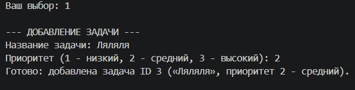

Ваш выбор: 1
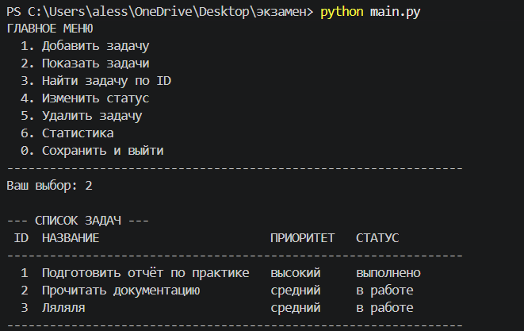

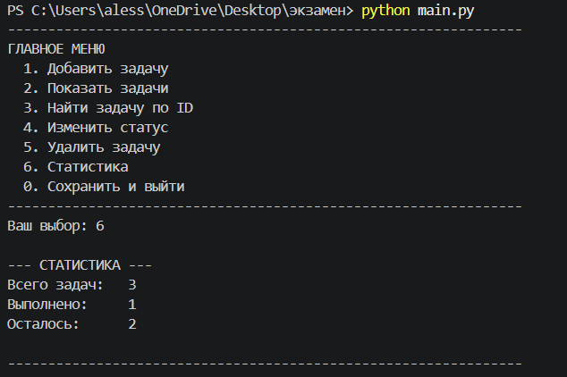


### Сценарий 2. Изменение статуса

```
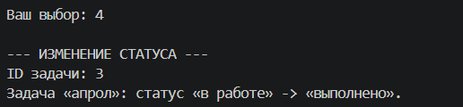

Повторный выбор пункта 4 для той же задачи возвращает статус «в работе»,
то есть переключение работает в обе стороны.

### Сценарий 3. Поиск и удаление по ID

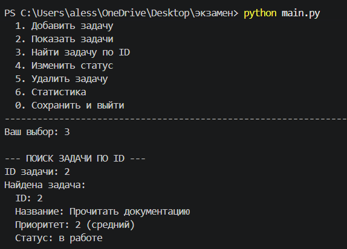

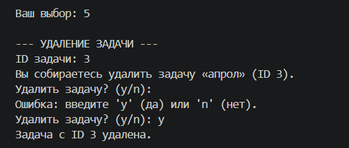

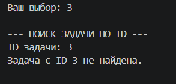

После удаления задача больше не находится по своему ID.

### Сценарий 4. Обработка ошибочного ввода

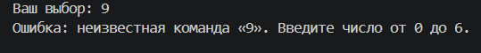

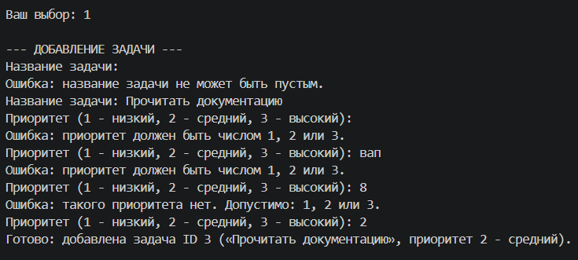


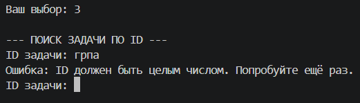
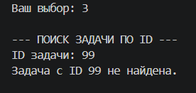


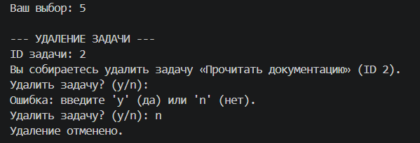

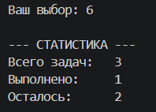


Ни одна ошибка не привела к аварийному завершению: после каждой из них
программа повторяла запрос или возвращала меню. Новая задача после удаления
второй снова получила свободный ID 2.

### Сценарий 5. Выход и повторный запуск с восстановлением задач

После пункта «0» данные записаны в `tasks.json`. При повторном запуске
`python main.py` программа сообщает о загруженных задачах и показывает их:


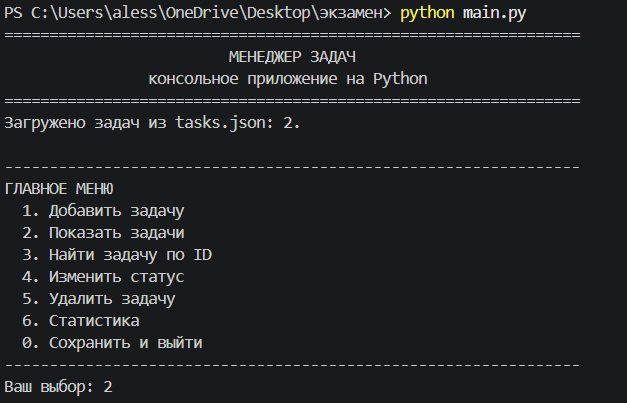

Названия, приоритеты и статусы сохранились, счётчик выполненных задач
восстановлен верно.

---
